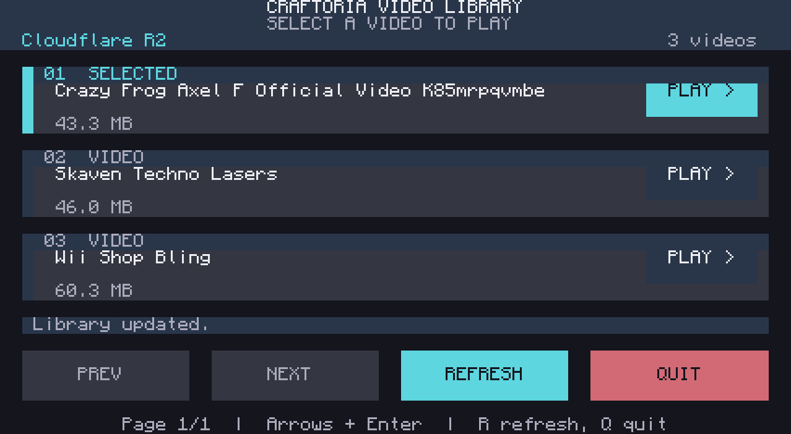

# Craftoria video player

A CC:Tweaked video player for a **7-wide x 4-high Advanced Monitor wall**, with audio through a connected Speaker. Start without arguments for a Cloudflare R2 video menu, or supply a local combined `.32vid` file or a direct HTTP(S) download URL.

## Open the video menu

Stop the existing player with Ctrl+T. Download the updated script to a fresh filename and launch it directly:

```text
wget https://raw.githubusercontent.com/Mavial/craftoria-video-player/main/video.lua video-touch.lua
video-touch.lua
```

Choose an unused filename if `video-touch.lua` already exists. The player discovers directly attached and wired-network Advanced Monitors and chooses the largest wall that fits the current 143x52-character recordings. It uses text scale **1.0 for the menu** when the display has enough room, and switches to **0.5 for playback** to preserve the recording's full resolution. Smaller screens use a compact menu at 0.5, with a clear size error if a recording does not fit. With no Advanced Monitor connected, the menu stays on the computer for keyboard use. The R2 catalogue URL is already configured.

If several displays are connected and you want a particular wall, run `set video.monitor monitor_5` with its peripheral name, then launch the player. Use `set video.monitor nil` to return to automatic selection. The old `monitor MONITOR_NAME video-touch.lua` command still works, keeps its explicitly chosen monitor, and configures its scale automatically. Quit, errors and Ctrl+T restore the previous terminal. Touches on other monitors and mouse clicks in the computer GUI do not control an automatically selected wall.

To run at computer boot, copy the player to an unused startup filename:

```text
copy video-touch.lua startup.lua
```

If this computer already has a startup script, use `shell.run("video-touch.lua")` in that script instead. If you previously copied the whole old player into `startup.lua`, replace that player copy with the updated version.

Tap anywhere on a video card to play, including its header, title, size label or PLAY area. The SCADA-inspired menu uses dark panels, cyan selection accents and full-height Previous, Next, Refresh and Quit buttons. Long titles wrap across two lines on the wall. Page buttons are disabled when there is no previous/next page; spaces between cards do not start playback. The layout adapts to smaller computer screens and monitor resizing.

Use Up/Down and Enter from the computer for keyboard selection. Touch during playback or press Backspace to stop and return to the menu. Completed videos return automatically, with the larger menu scale and its palette restored. Left/Right changes pages, R refreshes, and Q quits.



This preview renders the actual Lua menu's character cells with the installed CC:Tweaked font and an example catalogue; it is not an in-world screenshot. A [compact computer preview](previews/menu-computer.png) is also available.

The menu lists the `.32vid` objects under `videos/` in the dedicated `craftoria-video-player` R2 bucket. A Cloudflare Worker builds the catalogue dynamically, follows R2 pagination, and streams recordings from the bucket. Upload or delete a converted recording in that prefix, then click Refresh to update the menu. Each row includes the file size. See [R2 deployment and upload instructions](r2/README.md).

HTTP access must allow `craftoria-video-player.raftoria.workers.dev`. The list loads on launch and on explicit refresh; playback uses the current session's list. A failed refresh keeps the previous list and displays the error. Video files are downloaded over HTTP and are not saved to the computer disk. The player retains its GitHub source adapter for migration and continues to accept direct file/URL arguments.

## Play Wii Shop Bling

Use the updated `video-touch.lua`; monitor discovery and scale setup are automatic:

```text
video-touch.lua https://craftoria-video-player.raftoria.workers.dev/videos/wii-shop-bling.32vid
```

Hold Ctrl+T in the computer GUI to stop the previous recording before entering the new command. The new recording starts at the beginning; the YouTube radio playlist is not included.

For a new computer, download the player first:

```text
wget https://raw.githubusercontent.com/Mavial/craftoria-video-player/main/video.lua video-touch.lua
```

The ten-second test clip has been removed from R2 and GitHub; click Refresh in the menu to update the list.

## Available recordings

To add your own videos, use the [automatic uploader](UPLOADING.md). On the configured PC, run `python .\video-player\upload_video.py "YOUTUBE_URL"` from the Craftoria workspace, then click Refresh on the monitor.

Click Refresh in the menu to see the current library. These hosted recordings were upgraded from 7 FPS after the server's HTTP download limit was increased to 64 MiB:

| Recording | Duration | FPS | File size | Conversion and validation |
| --- | --- | --- | --- | --- |
| [Wii Shop Bling](https://www.youtube.com/watch?v=gYOEyzBFYa4), uploaded by eck | 4:04 | 30 | 60,284,886 bytes | [Record](recordings/wii-shop-bling.json) |
| [SKAVEN TECHNO LASERS / Francis E Dec Remix](https://www.youtube.com/watch?v=TXCUenE0b5A), uploaded by Karl the Deranged | 3:29 | 24 | 46,009,476 bytes | [Record](recordings/skaven-techno-lasers.json) |
| [Crazy Frog - Axel F (Official Video)](https://www.youtube.com/watch?v=k85mRPqvMbE) | 2:52 | 25 | 43,288,340 bytes | [Record](recordings/crazy-frog.json) |

Each recording starts at the beginning and includes complete audio. The linked records include checksums verified against the public R2 downloads.

## Recording and hardware

Source: [Wii Shop Bling, uploaded by eck](https://www.youtube.com/watch?v=gYOEyzBFYa4).

The current R2 recordings use **24-30 FPS**, 286x156 subpixels (143 columns x 52 rows at text scale 0.5), ANS video compression and mono 48 kHz DFPWM audio. Wii Shop Bling covers the complete video, with final-frame and silent padding to 244 seconds. The encoded picture is letterboxed rather than stretched. The dedicated server's HTTP download limit is now **64 MiB**, as reported by the user. The uploader defaults to 67,108,863 bytes, one byte below `max_download = 67108864`, and tries up to 30 FPS, rounded to the source's whole-number frame rate if lower. It falls back to lower rates when a recording is too large. The player and Worker need no code changes for this increase. The higher frame rate improves motion; the resolution remains matched to the wall.

Use 28 joined Advanced Monitors, one dedicated Advanced Computer and one connected Speaker. The computer may touch the wall directly or connect over wired modems and Networking Cable. HTTP playback avoids writing the full recording to the computer disk. The server must permit the configured R2 Worker hostname.

The current higher frame rate recordings are hosted on R2. The GitHub v1.1.0 release retains the original 7 FPS Wii recording; its root `manifest.json` and `verification.json` describe that historical version. Test clips were removed from hosting. Current R2 conversion, checksum and simulated playback results are under `recordings/`. `menu-verification.json` records checks using the installed CC:Tweaked scheduler and monitor program with simulated peripherals and catalogues: full card/button touch targets, automatic monitor selection, menu/playback scale switching, responsive layout bounds, resize handling, touch isolation, terminal restoration, pinned displays, legacy launches, disconnection/termination cleanup, keyboard selection, pagination, refresh, errors, stopping, replay and audio state. The Worker checks cover catalogue pagination, exact download bytes, metadata, and route restrictions. The R2 menu, playback and automatic monitor startup were confirmed working in-world by the user; the new touch layout was checked with simulated peripherals and rendered for visual review.

## Upstream and licensing

The player derives from [Sanjuuni 0.5's `32vid-player-mini.lua`](https://github.com/MCJack123/sanjuuni/blob/0.5/32vid-player-mini.lua). Changes retain DFPWM decoder state, retry rejected speaker buffers, yield while waiting for frames, and close the input handle after successful playback. The source is distributed with the upstream project's GNU GPL version 2 license in `LICENSE`.

The GPL applies to the software. The source video's audio and images retain their original rights and attribution.
